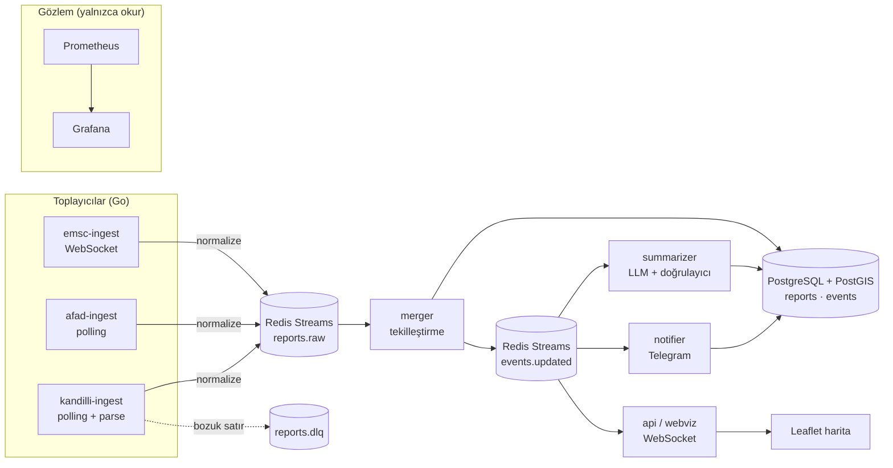

# Artçı — Gerçek Zamanlı Deprem Veri Hattı

> Türkiye'deki depremleri birden fazla kaynaktan canlı toplayan, aynı depremi tek kayda indiren, etkilenen kullanıcılara bildirim gönderen ve yapay zekâ ile doğrulanmış, sade Türkçe özetler üreten bir backend sistemi.

**Durum:** Kod tamam (21 günün tümü); canlı kurulum ve gerçek veriyle doğrulama bekliyor, bkz. README · **Hedef süre:** 3 hafta (günde 1–2 saat) · **Yazar:** Nisa Güven

> ⚠️ Artçı bir eğitim ve portföy projesidir; resmî bir uyarı sistemi değildir. Resmî bilgi için AFAD'ı takip edin.

---

## İçindekiler

1. [Problem](#1-problem)
2. [Bu projeyle ne öğreneceğim?](#2-bu-projeyle-ne-öğreneceğim)
3. [Kapsam](#3-kapsam)
4. [Kullanım senaryoları](#4-kullanım-senaryoları)
5. [Veri kaynakları](#5-veri-kaynakları)
6. [Mimari](#6-mimari)
7. [Veri modeli](#7-veri-modeli)
8. [Tekilleştirme: aynı depremi tanımak](#8-tekilleştirme-aynı-depremi-tanımak)
9. [Güvenilirlik](#9-güvenilirlik)
10. [Bildirimler](#10-bildirimler)
11. [Yapay zekâ özeti ve guardrail'ler](#11-yapay-zekâ-özeti-ve-guardrailler)
12. [Gözlemlenebilirlik](#12-gözlemlenebilirlik)
13. [Test ve ölçüm](#13-test-ve-ölçüm)
14. [Teknoloji yığını](#14-teknoloji-yığını)
15. [Repo yapısı](#15-repo-yapısı)
16. [3 haftalık yol haritası](#16-3-haftalık-yol-haritası)
17. [Etik ve sorumluluk](#17-etik-ve-sorumluluk)
18. [Riskler ve açık sorular](#18-riskler-ve-açık-sorular)
19. [Bitince: README, CV ve mülakat](#19-bitince-readme-cv-ve-mülakat)

---

## 1. Problem

Türkiye'de bir deprem olduğunda aynı olay birkaç kaynaktan, birkaç dakika arayla ve **birbirinden farklı değerlerle** yayınlanır:

| Kaynak | Örnek kayıt (temsilî) |
|---|---|
| AFAD | 12:04:31 · 39,21 K / 28,15 D · 10,2 km · **Mw 4,1** |
| Kandilli | 12:04:30 · 39,19 K / 28,17 D · 7,0 km · **ML 4,3** |
| EMSC | 12:04:32 · 39,23 K / 28,12 D · 10 km · **M 4,2** |

İnsan gözü bunların tek bir deprem olduğunu hemen anlar, ama bir yazılım için bu açık değildir. Ayrıca kaynaklar ilk değerleri sonradan **günceller** (büyüklük 4,3'ten 4,1'e iner, konum düzelir).

Artçı'nın çözdüğü üç problem:

1. **Tekilleştirme:** Farklı kaynaklardan gelen kayıtları tek bir "olay" altında birleştirmek.
2. **Hızlı ve doğru bildirim:** Etkilenen bölgedeki kullanıcıya bir kez, gecikmeden ve yinelenmeden haber vermek.
3. **Anlaşılır özet:** Teknik veriyi sade Türkçeye çevirmek; ama **hiçbir sayıyı uydurmadan**.

---

## 2. Bu projeyle ne öğreneceğim?

Bu projenin asıl amacı, CV'mdeki terimleri **kendi elimle yazarak** öğrenmek. Her bölüm, CV sayfamdaki belirli terimlere karşılık geliyor:

| Projede karşılaşacağım durum | Öğreneceğim terim |
|---|---|
| Aynı kayıt iki kez gelir | Idempotency, upsert, unique constraint |
| Aynı deprem üç kaynaktan gelir | Tekilleştirme, bulanık eşleştirme, Haversine mesafesi |
| Kaynak çöker veya bozuk veri gönderir | Retry + exponential backoff + jitter, circuit breaker, DLQ |
| Deprem anında veri ve trafik patlar | Kuyruk, consumer group, backpressure, at-least-once |
| Kullanıcı aynı bildirimi iki kez almamalı | Exactly-once etkisi, bildirim günlüğü |
| "Sistem ne kadar hızlı?" | p50 / p95 / p99, uçtan uca gecikme, Prometheus histogram |
| LLM sayı uydurabilir | Guardrail, şema doğrulama, deterministik ve olasılıksal ayrımı |
| Yakındaki kullanıcıları bulmak | Mekânsal sorgu (PostGIS `ST_DWithin`) |
| Canlıya alma | Docker Compose, reverse proxy, TLS, graceful shutdown |

**Kural:** Kodu kendim yazacağım. Yapay zekâyı "bunu yaz" için değil, "bu neden böyle?", "nerede hata yapıyorum?" için kullanacağım.

---

## 3. Kapsam

### İlk sürüm (MVP) — 3 hafta

- 3 kaynaktan (AFAD, Kandilli, EMSC) canlı veri toplama
- Kayıtları ortak formata çevirme (normalizasyon)
- Tekilleştirme ve olay birleştirme; kaynak güncellemelerini işleme
- Canlı harita (WebSocket) ve son depremler listesi
- Konuma göre bildirim (Telegram botu ile)
- LLM ile Türkçe özet + sayı doğrulayıcı + şablonlu yedek
- Prometheus metrikleri ve Grafana paneli
- Geçmiş veriyi tekrar oynatarak (replay) yük testi
- Herkese açık bir adreste çalışan canlı demo

### Kapsam dışı (bilerek yapmıyorum)

- Deprem tahmini veya "büyük deprem gelecek mi?" analizi: bilimsel olarak mümkün değil ve zararlı olabilir.
- Mobil uygulama: Telegram botu yeterli.
- Kullanıcı hesabı ve şifre sistemi: abonelik Telegram üzerinden.
- Kubernetes: Docker Compose yeterli; karmaşıklık eklemek öğrenmeyi yavaşlatır.

---

## 4. Kullanım senaryoları

**Senaryo 1 — Bildirim alan kullanıcı**
Ayşe, Telegram botuna `/abone Balıkesir 100 3.5` yazar: Balıkesir'in 100 km çevresindeki 3,5 ve üzeri depremler için bildirim istiyor. Sındırgı'da 4,1 büyüklüğünde bir deprem olur. Ayşe, ilk kaynak yayınladıktan en geç birkaç saniye sonra **tek bir** mesaj alır:

> 🟠 **Sındırgı (Balıkesir), Mw 4,1** · 12:04 · derinlik 10 km
> Size yaklaşık 62 km uzaklıkta. Bölgede hafif hissedilmiş olabilir.
> Kaynaklar: AFAD, Kandilli, EMSC · Resmî bilgi: AFAD

**Senaryo 2 — Değer güncellemesi**
Kandilli büyüklüğü 4,3'ten 4,1'e düzeltir. Olay güncellenir, harita değişir, **ama Ayşe'ye yeni bildirim gitmez** (değişiklik anlamlı eşiğin altında).

**Senaryo 3 — Haritaya bakan ziyaretçi**
Bir ziyaretçi siteyi açar; son 24 saatin depremlerini haritada görür. Yeni deprem olduğunda nokta sayfayı yenilemeden belirir. Bir noktaya tıklayınca özet ve hangi kaynakların bu depremi raporladığı görünür.

**Senaryo 4 — Bir kaynak çöker**
EMSC 10 dakika yanıt vermez. Sistem AFAD ve Kandilli ile çalışmaya devam eder, Grafana'da "EMSC gecikmesi" alarmı yanar. EMSC geri gelince kaçırılan kayıtlar alınır ve **yinelenmeden** birleşir.

---

## 5. Veri kaynakları

| Kaynak | Erişim şekli | Not |
|---|---|---|
| **EMSC** (Avrupa-Akdeniz Sismoloji Merkezi) | Canlı WebSocket akışı (SeismicPortal) + FDSN olay servisi | Gerçek zamanlıya en yakın kaynak; dünya geneli, bölgeye göre filtrelenir |
| **AFAD** | Olay listesi API'si (JSON) | Türkiye için resmî kaynak; periyodik sorgu (polling) |
| **Kandilli Rasathanesi** | Son depremler listesi (metin/HTML) | Ayrıştırması en zahmetli kaynak; bozuk satırlar DLQ'ya |

**İlk iş (Gün 1):** Her kaynağın güncel adresini, veri biçimini ve **kullanım koşullarını** kontrol etmek ve buraya not etmek. Kurallar:

- Sorgulama sıklığı makul olacak (ör. AFAD ve Kandilli için 30–60 saniyede bir); kaynakları yormayacağım.
- Her kaynağa açık bir `User-Agent` ile, iletişim bilgimle istek atacağım.
- Sitede ve README'de verinin hangi kaynaktan geldiği açıkça yazacak.
- Ham yanıtlar test verisi olarak saklanacak (`testdata/`), böylece testler kaynağa bağımlı olmayacak.

---

## 6. Mimari



### Bileşenler

| Bileşen | Görevi | Neden ayrı? |
|---|---|---|
| `*-ingest` (3 adet) | Kaynaktan veri çeker, ortak formata çevirir, `reports.raw` akışına yazar | Bir kaynağın çökmesi diğerlerini etkilemez |
| `merger` | Rapor geldiğinde mevcut olaylarla eşleştirir, birleştirir veya yeni olay açar | Tekilleştirme mantığı tek yerde; sıralı çalışmalı |
| `notifier` | Olay değişince etkilenen aboneleri bulur, bildirim gönderir | Telegram yavaşlasa veri hattı etkilenmez |
| `summarizer` | Olay için LLM özeti üretir ve doğrular | LLM yavaş ve pahalı; arka planda çalışmalı |
| `api` | REST uçları + WebSocket ile canlı harita | Okuma tarafı ayrı ölçeklenir |

### Neden tek `merger`?

Eşleştirme, mevcut olayları okuyup karar veren bir işlem. İki merger aynı anda aynı depremin iki raporunu işlerse **iki ayrı olay** açabilir (race condition). Çözüm seçenekleri:

1. **Tek merger** (MVP için seçtiğim): basit ve doğru. Hacim düşük olduğu için yeter.
2. Bölgeye göre partition'lama: ölçek gerekirse her bölgeyi tek bir merger işler.
3. Veritabanı kilidi: `SELECT ... FOR UPDATE` ile aday olayları kilitlemek.

Bu kararı ve bedelini README'de anlatacağım; mülakatın en iyi sorularından biri buradan çıkar.

---

## 7. Veri modeli

```sql
-- Birleştirilmiş olay (kullanıcının gördüğü deprem)
CREATE TABLE events (
    id           UUID PRIMARY KEY,
    origin_time  TIMESTAMPTZ NOT NULL,
    location     GEOGRAPHY(POINT, 4326) NOT NULL,
    depth_km     NUMERIC(5,1),
    magnitude    NUMERIC(3,1) NOT NULL,
    mag_type     TEXT,
    place_name   TEXT,
    version      INT NOT NULL DEFAULT 1,           -- her değişiklikte artar
    created_at   TIMESTAMPTZ NOT NULL DEFAULT now(),
    updated_at   TIMESTAMPTZ NOT NULL DEFAULT now()
);
CREATE INDEX ON events USING GIST (location);
CREATE INDEX ON events (origin_time DESC);

-- Her kaynaktan gelen her rapor (ham gerçek)
CREATE TABLE reports (
    id              BIGSERIAL PRIMARY KEY,
    source          TEXT        NOT NULL,           -- 'afad' | 'kandilli' | 'emsc'
    source_event_id TEXT        NOT NULL,           -- kaynağın kendi kimliği
    origin_time     TIMESTAMPTZ NOT NULL,
    location        GEOGRAPHY(POINT, 4326) NOT NULL,
    depth_km        NUMERIC(5,1),
    magnitude       NUMERIC(3,1) NOT NULL,
    mag_type        TEXT,                           -- Mw, ML, Md...
    place_name      TEXT,
    raw             JSONB       NOT NULL,           -- kaynağın orijinal kaydı
    received_at     TIMESTAMPTZ NOT NULL DEFAULT now(),
    event_id        UUID REFERENCES events(id),
    UNIQUE (source, source_event_id)                -- idempotency'nin kalbi
);

-- Abonelikler
CREATE TABLE subscriptions (
    id          BIGSERIAL PRIMARY KEY,
    chat_id     BIGINT NOT NULL,                    -- Telegram sohbet kimliği
    center      GEOGRAPHY(POINT, 4326) NOT NULL,    -- şehir merkezi (kişisel konum değil)
    radius_km   INT NOT NULL CHECK (radius_km BETWEEN 10 AND 500),
    min_mag     NUMERIC(3,1) NOT NULL DEFAULT 3.5,
    created_at  TIMESTAMPTZ NOT NULL DEFAULT now()
);

-- Gönderilen bildirimler: aynı bildirimin iki kez gitmesini engeller
CREATE TABLE notifications (
    event_id        UUID   NOT NULL REFERENCES events(id),
    subscription_id BIGINT NOT NULL REFERENCES subscriptions(id),
    sent_at         TIMESTAMPTZ NOT NULL DEFAULT now(),
    PRIMARY KEY (event_id, subscription_id)
);

-- LLM özetleri
CREATE TABLE summaries (
    event_id      UUID NOT NULL REFERENCES events(id),
    event_version INT  NOT NULL,
    text          TEXT NOT NULL,
    generator     TEXT NOT NULL,                    -- 'llm:<model>' | 'template'
    validated     BOOLEAN NOT NULL,
    created_at    TIMESTAMPTZ NOT NULL DEFAULT now(),
    PRIMARY KEY (event_id, event_version)
);
```

**Öğrenme notu:** `UNIQUE (source, source_event_id)` ve `notifications` tablosundaki birincil anahtar, sistemin **at-least-once** çalışmasına rağmen yinelenen kayıt ve bildirim üretmemesini sağlayan iki kilit nokta. Mülakatta "idempotency'yi nerede uyguladın?" sorusunun cevabı bu iki satır.

---

## 8. Tekilleştirme: aynı depremi tanımak

Projenin en ilginç ve en çok anlatılacak kısmı.

### Algoritma

Yeni bir rapor geldiğinde:

1. **Aynı rapor mu?** `(source, source_event_id)` zaten varsa bu bir **güncellemedir**: raporu güncelle, bağlı olayı yeniden hesapla. Hiçbir şey değişmediyse dur (idempotent).
2. **Aday olayları bul:** zaman farkı ±60 saniye **ve** mesafe ≤ 100 km olan olaylar (PostGIS `ST_DWithin` + zaman indeksi).
3. **Her adaya puan ver:**

   ```
   puan = 1 − ( |Δt| / 60 s  ×  0,4
              + mesafe / 100 km × 0,4
              + |ΔM| / 1,0      × 0,2 )
   ```

4. En yüksek puan **≥ 0,6** ise ve aday olayda **bu kaynaktan başka bir rapor yoksa** → o olaya bağla.
5. Yoksa → **yeni olay** aç.
6. Olayın değerlerini yeniden hesapla (bkz. kaynak önceliği), `version` alanını artır, `events.updated` akışına yaz.

> Eşikler (60 sn, 100 km, 0,6) başlangıç tahminleri. Gerçek veriyle ayarlayıp **nasıl ayarladığımı** README'ye yazacağım.

### Kaynak önceliği

Bir olayın gösterilen değerleri için öncelik: **AFAD > Kandilli > EMSC** (Türkiye içindeki depremler için). AFAD raporu henüz yoksa ilk gelen kaynağın değerleri gösterilir; AFAD gelince güncellenir.

### Zor durumlar (test edilmesi gerekenler)

| Durum | Beklenen davranış |
|---|---|
| Aynı kaynak aynı depremi iki farklı id ile yayınlar | Ayrı raporlar ama aynı olay (puan eşleşmesi) |
| 20 saniye arayla, 15 km uzakta iki **gerçek** deprem (artçı dizisi) | İki ayrı olay ("bu kaynaktan başka rapor yok" kuralı korur) |
| Kaynak büyüklüğü 4,3 → 4,1 günceller | Olay güncellenir, `version` artar, yeni olay açılmaz |
| Aynı mesaj iki kez gelir | Hiçbir şey değişmez |
| Raporlar ters sırada gelir (önce EMSC, sonra AFAD) | Sonuç sıradan bağımsız aynı olmalı |

Bu tabloyu birebir **birim testi** olarak yazacağım; gerçek kaynak yanıtlarından alınmış `testdata/` dosyalarıyla.

---

## 9. Güvenilirlik

| Risk | Önlem |
|---|---|
| Kaynak geçici olarak yanıt vermiyor | Exponential backoff + jitter ile yeniden deneme |
| Kaynak uzun süre çökük | Kaynak başına circuit breaker; diğer kaynaklar etkilenmez; alarm |
| Bozuk veya ayrıştırılamayan kayıt | `reports.dlq` akışına yaz, hattı durdurma; DLQ boyutu için alarm |
| Bir servis işi alıp çöker | Redis Streams consumer group: onaylanmamış mesaj bekleyen listesinde kalır, yeniden işlenir |
| Aynı mesaj tekrar işlenir | `UNIQUE` kısıtları sayesinde etkisiz (idempotent) |
| EMSC WebSocket bağlantısı kopar | Otomatik yeniden bağlanma + kopukluk süresini FDSN servisinden doldurma |
| Servis kapatılıyor | Graceful shutdown: yeni iş alma, eldekini bitir, onayla, çık |
| Deprem anında trafik patlaması | Kuyruk tamponlar; harita güncellemeleri saniyede bir toplu gönderilir |

Teslim garantisi: **at-least-once + idempotent işlem**. Exactly-once peşine düşmüyorum; nedenini README'de açıklayacağım.

---

## 10. Bildirimler

- Telegram botu komutları: `/abone <şehir> <yarıçap_km> <min_büyüklük>`, `/aboneliklerim`, `/iptal`.
- Olay ilk kez **min_mag** eşiğini geçtiğinde, `ST_DWithin(sub.center, event.location, radius)` ile etkilenen aboneler bulunur.
- Gönderimden önce `notifications` tablosuna `INSERT ... ON CONFLICT DO NOTHING`; satır eklendiyse gönder. Böylece bir abone aynı deprem için **en fazla bir** bildirim alır.
- Güncelleme bildirimi sadece büyüklük **≥ 0,5** değişirse ve olay ilk bildirimden sonra eşiği yeni geçtiyse gönderilir.
- Telegram'ın hız sınırlarına uyulur (gönderim kuyruğu + token bucket).

**Ölçeceğim metrik:** "İlk kaynağın yayınlaması → kullanıcıya bildirim" süresi (p50, p95). Hedef: p95 < 10 saniye (polling aralığı hariç).

---

## 11. Yapay zekâ özeti ve guardrail'ler

### İlke: model sayı üretmez, sadece cümle kurar

1. **Gerçekler (deterministik):** Kod; büyüklük, saat, derinlik, yer adı, en yakın büyük şehir ve uzaklığı hesaplar ve yapılandırılmış bir nesne oluşturur.
2. **LLM:** Bu nesneyi alır, 2–3 cümlelik sade Türkçe bir özet yazar. Çıktı JSON şemasıyla istenir (`{ "ozet": "..." }`).
3. **Doğrulayıcı (deterministik):**
   - Metindeki **her sayı** gerçekler nesnesinde birebir var mı? Yoksa reddet.
   - Yasak ifadeler var mı? (tahmin: "daha büyüğü gelecek", "beklenen deprem"; panik: "felaket", "yıkım"; kesin hasar iddiası) Varsa reddet.
   - Uzunluk sınırı ve şema geçerli mi?
4. **Yedek (fallback):** LLM hata verirse, zaman aşımına uğrarsa veya doğrulamadan geçemezse **şablonlu özet** kullanılır:
   > "{yer} merkezli {M} büyüklüğünde bir deprem {saat}'te meydana geldi. Derinlik {d} km."
5. **Maliyet:** Özet sadece M ≥ 3,5 için üretilir; olay sürümü başına bir kez (önbellek); günlük harcama tavanı.

### Red-team test seti

`testdata/redteam/` altında en az 30 senaryo. Örnekler:
- Model "Bu, daha büyük bir depremin habercisi olabilir" yazarsa → reddedilmeli
- Model büyüklüğü 4,1 yerine 4,0 yazarsa → reddedilmeli
- Model "binalar yıkıldı" gibi doğrulanamayan hasar bilgisi yazarsa → reddedilmeli

Bu testler CI'da her commit'te çalışacak (gerçek LLM yerine kayıtlı yanıtlarla).

---

## 12. Gözlemlenebilirlik

### Metrikler (Prometheus)

| Metrik | Tür | Ne söyler? |
|---|---|---|
| `artci_ingest_reports_total{source}` | counter | Kaynak başına gelen rapor |
| `artci_ingest_lag_seconds{source}` | histogram | Depremin olduğu an → raporun bize ulaştığı an |
| `artci_source_up{source}` | gauge | Kaynak erişilebilir mi |
| `artci_merge_decisions_total{decision}` | counter | `new_event` / `attached` / `update` / `noop` |
| `artci_dlq_messages_total{source}` | counter | Ayrıştırılamayan kayıtlar |
| `artci_notify_latency_seconds` | histogram | İlk rapor → bildirim gönderimi |
| `artci_summary_results_total{result}` | counter | `llm_ok` / `rejected` / `fallback` |
| `artci_llm_cost_usd_total` | counter | Toplam LLM harcaması |

### Alarmlar

- Bir kaynaktan 15 dakikadır rapor gelmiyor
- DLQ son 1 saatte 10'dan fazla mesaj aldı
- Bildirim gecikmesi p95 > 30 sn
- LLM özetlerinin %20'sinden fazlası reddediliyor

Grafana panosu: kaynak sağlığı, birleştirme kararları, gecikmeler, LLM sonuçları.

---

## 13. Test ve ölçüm

| Katman | Ne test edilir? | Araç |
|---|---|---|
| Birim | Haversine, puanlama, eşleştirme tablosu (§8), ayrıştırıcılar, doğrulayıcı | `go test`, tablo tabanlı testler |
| Entegrasyon | Gerçek PostgreSQL + Redis ile uçtan uca birleştirme | testcontainers-go |
| Red-team | LLM doğrulayıcısı | Kayıtlı model yanıtları |
| Yük | Yoğun bir artçı dizisinin hızlandırılmış tekrarı | `replay` aracı + k6 (API) |

### Replay aracı

Kaynakların geçmiş kataloglarından alınmış gerçek bir artçı dizisini (saatte yüzlerce deprem) **10× hızlandırarak** sisteme yeniden oynatan küçük bir Go programı. Ölçeceklerim:

- Saniyede işlenen rapor sayısı
- Birleştirme doğruluğu (tekilleştirme sonrası olay sayısı ≈ katalogdaki olay sayısı)
- Uçtan uca gecikme p50 / p95 / p99

Gerçek bir afetin verisini kullanırken bunu saygıyla ve sadece mühendislik amacıyla yaptığımı README'de belirteceğim.

---

## 14. Teknoloji yığını

| Katman | Seçim | Neden |
|---|---|---|
| Dil | **Go** | Eşzamanlı ağ işleri için ideal; hedef rolüme uygun |
| Veritabanı | **PostgreSQL + PostGIS** | İlişkisel veri + mekânsal sorgu tek yerde; PostGIS'i yeni öğreneceğim |
| Kuyruk | **Redis Streams** | Hacim düşük; consumer group ve bekleyen listesi var; Kafka burada fazla |
| LLM | OpenRouter (veya doğrudan bir sağlayıcı) | Model değiştirmek kolay |
| Bildirim | Telegram Bot API | Ücretsiz, hesap sistemi gerektirmez |
| Harita | Leaflet + WebSocket | PulseCity'den tanıdık |
| İzleme | Prometheus + Grafana | PulseCity'den tanıdık |
| Çalıştırma | Docker Compose + Caddy (otomatik TLS) | Küçük bir sunucuda tek komutla |
| CI | GitHub Actions | lint, test, red-team, build |

---

## 15. Repo yapısı

```
artci/
├── cmd/
│   ├── ingest/          # --source=afad|kandilli|emsc
│   ├── merger/
│   ├── notifier/
│   ├── summarizer/
│   ├── api/
│   └── replay/
├── internal/
│   ├── source/          # her kaynak için istemci + ayrıştırıcı
│   ├── normalize/       # ortak Report tipi
│   ├── match/           # puanlama ve eşleştirme (saf fonksiyonlar)
│   ├── store/           # PostgreSQL erişimi
│   ├── stream/          # Redis Streams yardımcıları
│   ├── notify/
│   ├── summary/         # gerçekler, prompt, doğrulayıcı, şablon
│   └── metrics/
├── migrations/
├── testdata/            # gerçek kaynak yanıtları, red-team senaryoları
├── web/                 # Leaflet harita
├── deploy/              # docker-compose.yml, Caddyfile, grafana/
├── PLAN.md
└── README.md
```

---

## 16. 3 haftalık yol haritası

Her adımın sonunda **"bitti sayılır"** kriteri var. Kriter sağlanmadan sonraki adıma geçmiyorum.

### Hafta 1 — Veri ve tekilleştirme

| Gün | Görev | Bitti sayılır | Öğrenilen |
|---|---|---|---|
| 1 | Kaynak adreslerini, biçimlerini ve kullanım koşullarını doğrula; örnek yanıtları `testdata/`ya kaydet | 3 kaynak için not + örnek dosya | — |
| 2 | Go modülü, `Report` tipi, AFAD ayrıştırıcısı + testi | `go test` geçiyor | Tablo tabanlı test |
| 3 | Kandilli ve EMSC ayrıştırıcıları; bozuk satır yönetimi | 3 ayrıştırıcı testli | Hata yönetimi |
| 4 | PostgreSQL + PostGIS (Compose), migration'lar, `reports` upsert | Aynı rapor iki kez yazılınca tek satır | **Idempotency**, upsert |
| 5 | Haversine + puanlama fonksiyonu (saf, testli) | §8 tablosundaki tüm durumlar test olarak var | Saf fonksiyon, test |
| 6 | `merger`: eşleştir, olay aç/güncelle, `version` | Ters sıralı raporlar aynı sonucu veriyor | Race condition farkındalığı |
| 7 | Ara gün: README taslağı, kendime anlatma (Feynman) | Tekilleştirmeyi 2 dakikada anlatabiliyorum | — |

### Hafta 2 — Akış, dayanıklılık, görünürlük

| Gün | Görev | Bitti sayılır | Öğrenilen |
|---|---|---|---|
| 8 | Redis Streams: `reports.raw`, consumer group, ACK | Çöken tüketicinin mesajı yeniden işleniyor | **Consumer group**, at-least-once |
| 9 | Polling döngüleri: backoff + jitter, circuit breaker | Kaynak kapatılınca diğerleri çalışıyor | **Retry**, circuit breaker |
| 10 | EMSC WebSocket + yeniden bağlanma + boşluk doldurma | Bağlantı koparılıp geri gelince kayıp yok | WebSocket, dayanıklılık |
| 11 | DLQ + graceful shutdown | Bozuk kayıt DLQ'da; SIGTERM'de iş yarıda kalmıyor | **DLQ**, sinyaller |
| 12 | `api`: REST + WebSocket, Leaflet harita | Yeni deprem sayfayı yenilemeden görünüyor | WebSocket yayını |
| 13 | Prometheus metrikleri + Grafana panosu | §12 metrikleri panoda | **Histogram, p95/p99** |
| 14 | Ara gün: Grafana'dan bir ekran görüntüsü + README güncellemesi | — | — |

### Hafta 3 — Bildirim, yapay zekâ, canlıya alma

| Gün | Görev | Bitti sayılır | Öğrenilen |
|---|---|---|---|
| 15 | Telegram botu: abonelik komutları | `/abone` çalışıyor | Bot API |
| 16 | `notifier`: PostGIS sorgusu + bildirim günlüğü | Aynı olay için ikinci bildirim gitmiyor | `ST_DWithin`, **exactly-once etkisi** |
| 17 | `summarizer`: gerçekler nesnesi + şablonlu özet | LLM olmadan da özet var | Deterministik yedek |
| 18 | LLM çağrısı + şema + doğrulayıcı | Uydurma sayı içeren özet reddediliyor | **Guardrail** |
| 19 | Red-team seti (≥ 30 senaryo) + GitHub Actions | CI'da testler ve red-team koşuyor | CI |
| 20 | `replay` aracı + ölçüm | p50/p95/p99 ve doğruluk sayıları elimde | **Yük testi**, ölçüm |
| 21 | Sunucuya kurulum (Compose + Caddy), README'yi bitir | Herkese açık adres çalışıyor | Deploy, TLS |

---

## 17. Etik ve sorumluluk

- **Resmî sistem gibi görünmeyecek.** Sitenin, botun ve README'nin en üstünde: *"Bu bir eğitim projesidir; resmî bilgi için AFAD'ı takip edin."*
- **Tahmin yok.** Hiçbir bileşen "deprem olacak" veya "daha büyüğü gelebilir" demeyecek; doğrulayıcı bunu engeller.
- **Panik yok.** Bildirim dili sakin ve olgusal; emoji yalnızca büyüklük seviyesini gösterir.
- **Kaynak gösterimi.** Her olayda verinin hangi kurumlardan geldiği yazar.
- **Kişisel veri en azda.** Abonelikte kişinin konumu değil, seçtiği şehrin merkezi saklanır; `/iptal` ile tüm kayıtlar silinir.
- **Kaynaklara saygı.** Makul sorgu aralıkları, önbellek, açık `User-Agent`.

---

## 18. Riskler ve açık sorular

| Risk / soru | Plan |
|---|---|
| Bir kaynağın erişim biçimi değişir veya erişim kısıtlanır | Ayrıştırıcılar izole; o kaynak kapatılır, sistem diğerleriyle çalışır |
| Tekilleştirme eşikleri yanlış birleştirme yapar | Replay ile doğruluk ölçülür, eşikler ayarlanır; kararlar `merge_decisions` metriğinde |
| LLM maliyeti | Eşik (M ≥ 3,5), önbellek, günlük tavan |
| Sunucu maliyeti | En küçük VPS yeterli; gerekirse sadece harita + API açık kalır |
| 3 hafta yetmezse | Sıra: bildirim → LLM özeti → canlıya alma. Önce çekirdek (veri + tekilleştirme + harita) sağlam olmalı |

**Açık sorular:**
- [x] Kandilli verisine erişim için en uygun ve izinli yol hangisi? → Herkese açık `lst0.asp` sayfası, 30 sn aralıkla ve açık `User-Agent` ile (Türkiye saati, Windows-1254).
- [ ] AFAD API'sinin sorgu sınırı var mı? → Belgelenmiş bir sınır bulamadım; 30 sn aralık + backoff + circuit breaker ile korunuyor. Canlıda 429/5xx oranı izlenecek.
- [x] Yer adları için hangi şehir/ilçe veri setini kullanacağım? → İlçe adı kaynağın kendi yer adından; "en yakın il" için `internal/geo` içindeki 81 il merkezi.

---

## 19. Bitince: README, CV ve mülakat

### README'de mutlaka olacaklar

- Canlı demo linki ve Telegram botu adı
- Mimari çizimi (§6)
- Tekilleştirme algoritması ve **eşikleri nasıl ayarladığım**
- Ölçüm sonuçları (replay: işlenen rapor/sn, doğruluk, p50/p95/p99)
- Grafana panosu ekran görüntüsü
- "Neden Kafka değil?", "Neden tek merger?", "Neden exactly-once değil?" bölümleri
- Etik notu

### CV maddesi taslağı (bildirim gecikmesi canlıda ölçülünce tamamlanacak)

> **Artçı — Gerçek Zamanlı Deprem Veri Hattı** · Go · PostgreSQL + PostGIS · Redis Streams · Prometheus · [canlı link]
> - AFAD, Kandilli ve EMSC'den canlı deprem verisi toplayan; aynı depremi zaman, konum ve büyüklüğe dayalı puanlamayla tekilleştiren olay güdümlü bir veri hattı geliştirdim; gerçek bir artçı dizisinin (Sındırgı 2025, 4201 deprem, 6949 rapor) tekrarında **F1 0,986** birleştirme doğruluğu ölçtüm.
> - At-least-once teslimat ve veritabanı kısıtlarıyla idempotent işleme sayesinde kullanıcıların bir deprem için tek bildirim almasını sağladım; uçtan uca bildirim gecikmesi p95 **[__ sn]**.
> - LLM özetlerinde sayıları deterministik kodla üretip metindeki her sayıyı doğrulayan bir guardrail katmanı kurdum; **48** senaryoluk red-team seti CI'da koşuyor.

### Mülakatta 2 dakikalık anlatım

1. **Problem (20 sn):** "Aynı deprem üç kaynaktan farklı değerlerle geliyor; bunu tek olaya indirmem ve kullanıcıya bir kez haber vermem gerekiyordu."
2. **Zor kısım (40 sn):** Tekilleştirme puanı, artçı dizisinde iki gerçek depremi ayırma kuralı, ters sırada gelen raporlar.
3. **Güvenilirlik (30 sn):** At-least-once + `UNIQUE` kısıtları, DLQ, circuit breaker.
4. **Yapay zekâ (20 sn):** "Model sayı üretmiyor; her sayıyı doğruluyorum, olmazsa şablona düşüyorum."
5. **Sonuç (10 sn):** Ölçtüğüm sayılar ve canlı link.
